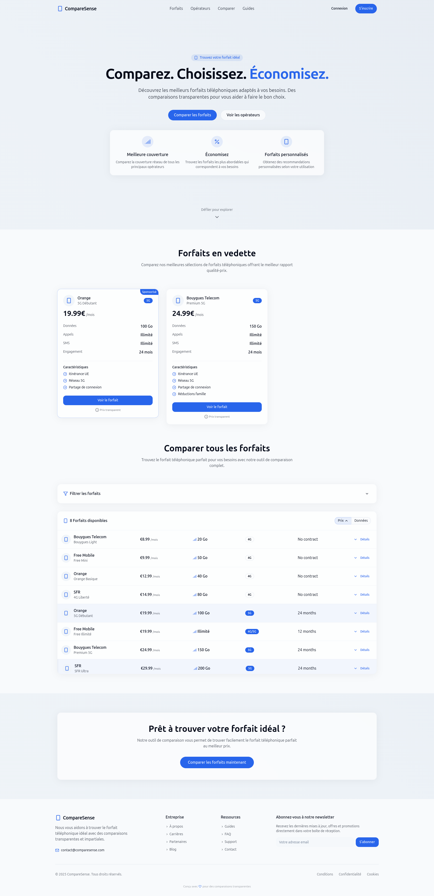

Here is the README template for the project based on the design you uploaded:

---

# CompareSense

CompareSense is a web application that helps users compare mobile phone plans in France. It allows users to find the best deals on mobile networks based on their needs, with transparent comparisons between operators. The platform offers features like real-time plan comparisons, price sorting, and filter options to help users make informed decisions.

## Features

- **Mobile Plan Comparison**: Compare the best phone plans and networks to suit your needs.
- **Featured Plans**: Highlight the best mobile plans offering the best value for money.
- **Price Sorting & Filtering**: Easily sort and filter mobile plans by price, data, and contract length.
- **Personalized Recommendations**: Find personalized plans based on your usage and preferences.
- **Multilingual Support**: Available in French to ensure maximum accessibility.
- **Newsletter Signup**: Stay up to date with the latest offers and plans by subscribing to the newsletter.

## Technologies

- **Frontend**:
  - React.js
  - Tailwind CSS
  - Vite for fast builds
  - React Router for navigation
- **Backend**:
  - Node.js (Optional if backend APIs are required)
  - REST API (if applicable for fetching mobile plans)
- **Others**:
  - Vercel for hosting
  - Unsplash for stock images

## Installation

To run the project locally, follow these steps:

1. Clone the repository:
   ```bash
   git clone <repository-url>
   ```

2. Navigate to the project directory:
   ```bash
   cd CompareSense
   ```

3. Install dependencies:
   ```bash
   npm install
   ```

4. Start the development server:
   ```bash
   npm run dev
   ```

The application will be accessible at `http://localhost:3000`.

## Configuration

- **Environment Variables**: If you're using any external APIs to fetch mobile plan data, ensure to set your API keys in the `.env` file.
- **Vite Configuration**: Adjust Vite config files if necessary for production builds or optimizations.

## Screenshots



## Footer Links

- **Company Info**:
  - About Us
  - Careers
  - Blog
- **Resources**:
  - Guides
  - FAQ
- **Legal**:
  - Terms & Conditions
  - Privacy Policy
  - Cookies Policy

## Contributing

If you'd like to contribute to the development of CompareSense, feel free to fork the repository and create pull requests with improvements or bug fixes.

## License

Distributed under the MIT License. See `LICENSE` for more information.

## Developer

- **Developer**: Ismail MOUYAHADA

## Footer

```
© 2025 CompareSense. All rights reserved.
```

 